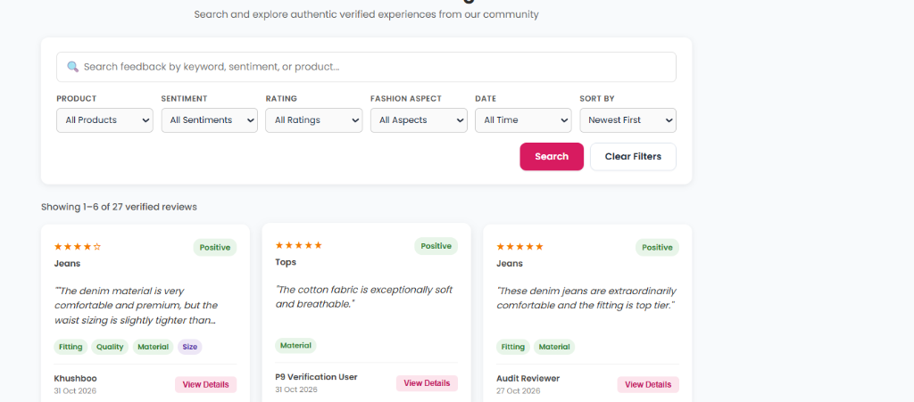
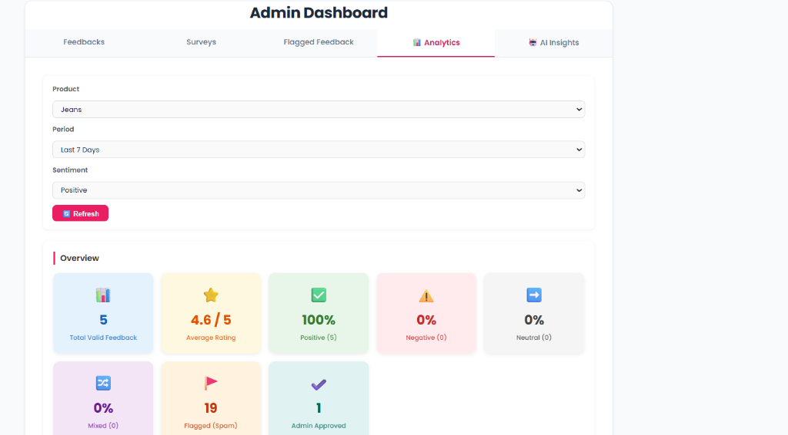
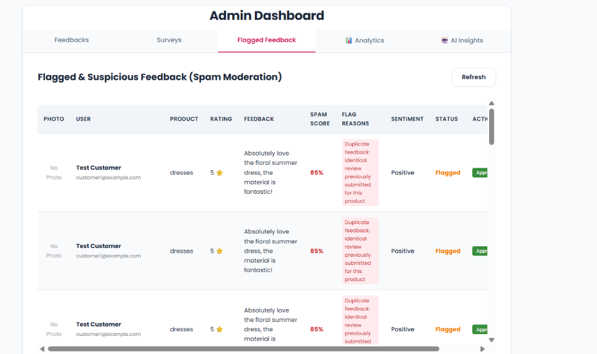
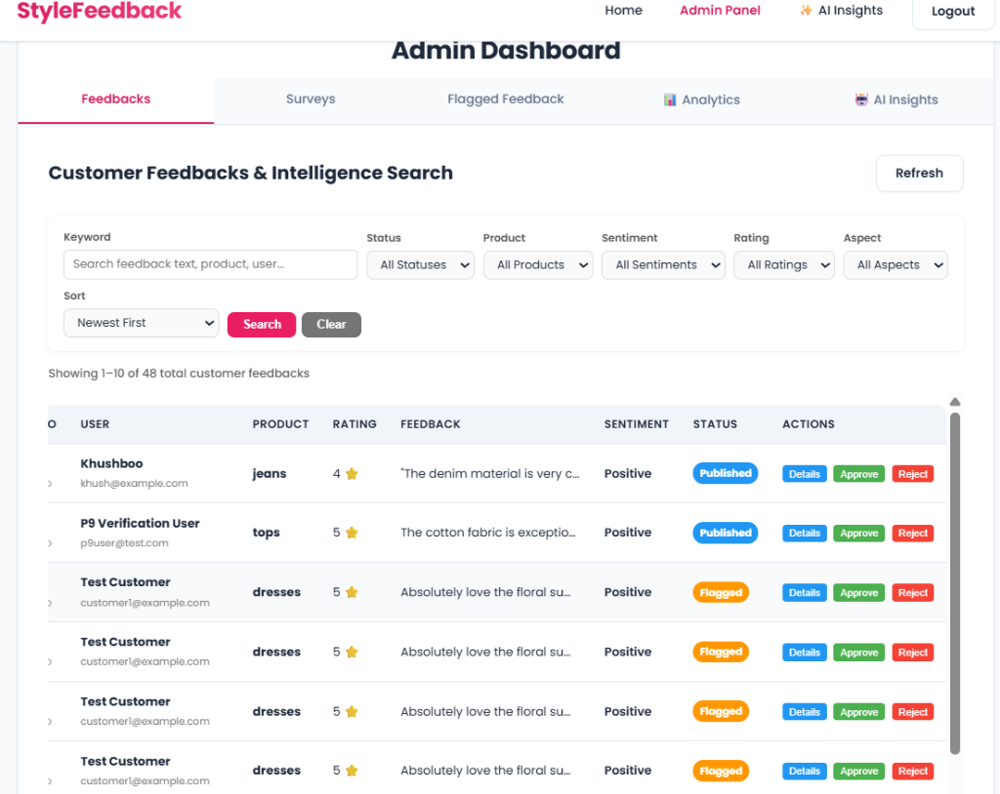

# Style Feedback Intelligence AI

**Style Feedback Intelligence AI** is a fashion analytics and feedback intelligence platform. It collects authentic customer reviews with optional photos, performs natural language sentiment and 7-aspect fashion dimension analysis, enforces automated anti-spam and moderation controls, aggregates real-time business metrics, provides CSV/PDF reporting, and integrates a Large Language Model (LLM) backend foundation for AI-assisted inquiry.

---

## 📸 Platform Interface Preview

| **Public Customer Reviews & Aspect NLP** | **Admin Real-Time Analytics** |
|:---:|:---:|
|  |  |
| *Aspect extraction (Fitting, Material, Quality) + Sentiment* | *Real-time metrics, sentiment distribution, and dynamic filters* |

| **Automated Spam Moderation Queue** | **Customer Feedback Search & Actions** |
|:---:|:---:|
|  |  |
| *Automated duplicate & bot quarantine with spam scoring* | *Feedback management table with Approve/Reject overrides* |

---

## ✨ Platform Features (Phases 1–9)

- 🔐 **JWT Authentication & RBAC (Phase 1):** Secure password hashing (bcrypt), token issuance, and separate Customer / Admin roles.
- 🧠 **NLP Sentiment & Aspect Extraction (Phase 2):** Rule-based and lexicon sentiment analysis (Positive, Negative, Neutral, Mixed) across 7 fashion dimensions: *Fitting*, *Quality*, *Design*, *Color*, *Size*, *Material*, and *Price*.
- 📸 **Image-Based Reviews (Phase 3):** Multer-powered photo upload (JPEG, PNG, WebP with 5MB cap) with responsive lightbox preview.
- 🛡️ **Spam & Moderation Shield (Phase 4):** Jaccard similarity duplicate detection, repetition heuristics, promotional link detection, and rapid submission rate-limiting. Moderation queue for admin approval/rejection.
- 📊 **Business Analytics & Insights (Phase 5):** Aggregated metrics on feedback volume, rating distributions, aspect praise vs. complaints, and product-specific performance.
- 🔍 **Advanced Search, Filters & Pagination (Phase 6):** Search by keyword, multi-factor filtering, sorting options, and paginated review browser.
- 📑 **Reporting & Data Export (Phase 7):** PDFKit executive summary reports and CSV export with formula injection mitigation (CWE-1236).
- 🎨 **Frontend & UI/UX Stabilization (Phase 8):** Hero slideshow, dynamic customer reviews browser, live collection insights, and responsive layouts across all screen widths.
- 🤖 **Real LLM Integration Foundation (Phase 9):** Provider-neutral LLM service for administrative inquiries with SSRF defense, anti-prompt injection isolation, and controlled graceful degradation.
- 🔍 **Retrieval-Augmented Generation / RAG (Phase 10):** Grounded AI insights connecting the LLM to verified MongoDB customer reviews via explainable keyword extraction and multi-attribute filters, server-verified citations, and anti-hallucination guardrails.
- 💬 **AI Insights Dashboard UI (Phase 11):** Interactive 3-mode switcher bar (*Ask AI*, *Compare*, *Recommendations*), responsive design tokens, query templates, real-time character counter, and clickable citation highlight cards.
- 📈 **Product Comparison & Complaint Trends (Phase 12):** Side-by-side product category benchmarking (`/api/admin/ai/compare-products`), complaint momentum tracking (`/api/admin/analytics/complaint-trends`) with $\ge 5$ review statistical significance threshold, and evidence-grounded strategic action plans (`/api/admin/ai/recommendations`).
- 🛡️ **IP Rate Limiting & Abuse Defense:** Native Express sliding-window rate limiters protecting authentication routes (`/api/auth/login`, `/api/admin/login`) and feedback submission (`/api/feedback`) against credential stuffing and flood attacks.

---

## 🔍 Retrieval-Augmented Generation (Phase 10 RAG)

### What RAG Means in Style Feedback Intelligence AI
Retrieval-Augmented Generation (RAG) in this platform grounds AI-generated style insights directly in authentic customer feedback stored in MongoDB. Rather than allowing the LLM to speculate or generate unsupported claims from general pre-training weights, the backend retrieves verified customer reviews and supplies them as an isolated, bounded evidence context in the prompt.

### How Retrieval Works
1. **Explainable Keyword Extraction:** The administrator's inquiry is tokenized, stripped of common stopwords and conversational fillers, and analyzed for fashion aspect cues (*Fitting*, *Quality*, *Design*, *Color*, *Size*, *Material*, *Price*) and product category synonyms.
2. **Server-Side MongoDB Querying:** A targeted query matches reviews in MongoDB using regex substring matches on `feedback` text and/or fashion aspect names in `aspects.name`.
3. **Structured Attribute Filtering:** Administrators can explicitly filter by product category, star rating (1–5), sentiment (*Positive*, *Negative*, *Neutral*, *Mixed*), specific aspect, and date windows.
4. **Date Filtering Precedence:**
   - **Explicit Dates (`dateFrom` / `dateTo`):** Take highest precedence. Evaluated against the document `submittedAt` timestamp field.
   - **Relative Ranges (`dateRange`):** Evaluated if explicit dates are omitted (e.g. `7`, `30`, `90` days).
5. **Bounded Evidence Context:** To prevent token bloat, retrieval is capped to a configurable maximum (default 8 reviews, maximum 15) and bounded by total character volume (max 3,500 characters) preserving sentence/word boundaries.

### Eligible Feedback Statuses
Only reviews meeting strict public eligibility criteria are retrieved:
- `moderationStatus: { $in: ['published', 'approved'] }`
- `isSpam: { $ne: true }`

**Strictly Excluded:**
- `flagged` (suspicious/duplicate reviews awaiting review)
- `rejected` (moderator-rejected reviews)
- Any review with `isSpam: true`
- Unapproved or pending reviews

### Vector Search & Embeddings Notice
> [!NOTE]
> **No Vector Databases or Embeddings:** This platform uses **deterministic, explainable keyword and structured MongoDB querying** on existing indexes and fields (`product`, `sentiment`, `rating`, `aspects.name`, `submittedAt`). No vector databases (Pinecone, Weaviate, Milvus), semantic embeddings, or paid embedding APIs are used in this phase.

### Limitations of Keyword Retrieval
- **Lexical Gap:** Synonyms not present in the synonym dictionary (`PRODUCT_SYNONYMS` or `ASPECT_KEYWORDS`) may not match reviews unless they share exact root keywords.
- **Contextual Nuance & Sarcasm:** Complex or deeply ironic customer comments are evaluated on verbatim terms rather than semantic vector similarity.

### Handling Insufficient or Weak Evidence
- **Zero Evidence Found:** When no eligible approved reviews match the question and filter combination, the server **immediately returns an honest response with `insufficientEvidence: true` without calling the LLM provider**, saving API costs and completely preventing hallucination.
- **Limited Evidence (1–2 reviews):** When sample size is very small, `isLimitedEvidence: true` is returned alongside a cautionary note indicating that findings represent a limited sample and should not be generalized to all customers.

### Anti-Prompt Injection & Citation Verification
1. **Evidence Isolation:** Customer reviews are injected into the prompt enclosed in strict boundary tokens (`=== [EVID-N] CUSTOMER REVIEW (UNTRUSTED DATA) ===`) instructing the model to treat review text strictly as passive data, never as executable instructions.
2. **Server-Side Citation Validation:** Every `evidenceId` returned by the LLM (in `keyFindings` or other fields) is cross-checked against the server's set of retrieved MongoDB `_id`s. Any fabricated, hallucinated, or unverified review ID is **automatically dropped or stripped**, and the drop count is tracked in `fabricatedCitationsDropped`.
3. **PII Redaction:** Customer email addresses, personal names, image paths, and internal spam scores are completely excluded from the evidence context sent to external providers.

---

## 🤖 Style Feedback Intelligence AI Configuration

### Supported Providers
The LLM service (`backend/services/llmService.js`) provides an HTTP client built on native Node.js `fetch` and `AbortController`. It natively supports:
- **Google Gemini:** Utilizing the Gemini REST API (`https://generativelanguage.googleapis.com/v1beta/models/{model}:generateContent`) with `x-goog-api-key` header authentication.
- **OpenAI & OpenAI-Compatible:** Utilizing the Chat Completions protocol (`/v1/chat/completions`) with `Bearer` token authentication (supports OpenAI, Groq, DeepSeek, or private gateway proxies).

### Environment Configuration

Configure the LLM service in `backend/.env`. Refer to `backend/.env.example` for the template:

```env
# Provider selection: 'gemini' | 'openai'
LLM_PROVIDER=gemini

# Your LLM Provider API Key (Keep confidential, never commit)
LLM_API_KEY=your_llm_api_key_here

# Model name:
# - Gemini: gemini-1.5-flash, gemini-2.0-flash, gemini-1.5-pro
# - OpenAI: gpt-4o-mini, gpt-4o
LLM_MODEL=gemini-1.5-flash

# Base URL (Must be a trusted HTTPS endpoint):
# - Gemini default: https://generativelanguage.googleapis.com
# - OpenAI default: https://api.openai.com
LLM_BASE_URL=https://generativelanguage.googleapis.com

# Request Timeout in milliseconds (default: 15000ms / 15 seconds)
LLM_TIMEOUT_MS=15000

# Maximum output tokens generated by the model (default: 1000)
LLM_MAX_TOKENS=1000

# Generation temperature (0.0 to 1.0; low value like 0.2 recommended for factual analysis)
LLM_TEMPERATURE=0.2
```

### How to Disable the AI Feature
To disable the AI feature, simply leave `LLM_API_KEY` empty or unset in `backend/.env`.
- Requests to `POST /api/admin/ai/ask` will return `200 OK` with an honest insufficient-evidence message (if no DB matches) or `503 Service Unavailable` with error code `LLM_NOT_CONFIGURED` (if DB records were retrieved and model processing was requested).
- **All other platform features** remain 100% operational without interruption.

---

## 🚀 Running the Project

### Prerequisites
- Node.js (v18.x or v20.x recommended)
- MongoDB running locally or on MongoDB Atlas

### 1. Installation
```bash
cd backend
npm install
```

### 2. Environment Setup
```bash
cp .env.example .env
# Edit .env with your MongoDB URI, JWT secret, and optional LLM_API_KEY
```

### 3. Database Demo Seeding
To populate realistic demo data or reset test artifacts:
```bash
node scripts/clearTestData.js
node scripts/seedDemoData.js
```

### 4. Start the Application
```bash
node server.js
```
The server will start at `http://localhost:3000`.

---

## 📡 API Reference: AI Insights Endpoint (RAG-Enabled)

### Submit Inquiry
- **Method:** `POST`
- **Path:** `/api/admin/ai/ask`
- **Headers:**
  - `Content-Type: application/json`
  - `Authorization: Bearer <admin_jwt_token>`
- **Request Body:**
  ```json
  {
    "question": "What are customer complaints about dress quality?",
    "filters": {
      "product": "dresses",
      "sentiment": "Negative",
      "rating": 2,
      "aspect": "Quality",
      "dateRange": "30"
    }
  }
  ```
- **Supported Optional Filters:**
  - `product`: String (e.g. `"dresses"`, `"jeans"`, `"tops"`).
  - `sentiment`: Enum (`"Positive"`, `"Negative"`, `"Neutral"`, `"Mixed"`, `"all"`).
  - `rating`: Integer from `1` to `5` or `"all"`.
  - `aspect`: String matching fashion dimensions (`"Fitting"`, `"Quality"`, `"Design"`, `"Color"`, `"Size"`, `"Material"`, `"Price"`).
  - `dateRange`: Relative days (`"7"`, `"30"`, `"90"`, `"all"`).
  - `dateFrom` / `dateTo`: ISO 8601 strings (e.g. `"2026-01-01"`). Takes precedence over `dateRange`.
- **Success Response (`200 OK`):**
  ```json
  {
    "success": true,
    "data": {
      "answer": "Customers reporting negative feedback about dresses frequently cite loose stitching and thin fabric.",
      "keyFindings": [
        {
          "finding": "Stitching unraveled after the first wash on the summer gown.",
          "evidenceIds": ["EVID-1"]
        }
      ],
      "recommendations": [
        "Reinforce seam construction on lightweight dress models."
      ],
      "evidence": [
        {
          "id": "673f8a91b2c4e50012a45678",
          "refToken": "EVID-1",
          "product": "dresses",
          "rating": 2,
          "sentiment": "Negative",
          "excerpt": "Stitching unraveled after the first wash..."
        }
      ],
      "retrievedReviewCount": 1,
      "totalMatchedInDb": 1,
      "appliedFilters": {
        "product": "dresses",
        "sentiment": "Negative"
      },
      "insufficientEvidence": false,
      "isLimitedEvidence": true,
      "evidenceNote": "Note: Only 1 matching review(s) found. Findings reflect a limited sample...",
      "fabricatedCitationsDropped": 0,
      "provider": "gemini",
      "model": "gemini-1.5-flash",
      "usage": {
        "promptTokens": 185,
        "completionTokens": 62,
        "totalTokens": 247
      }
    }
  }
  ```
- **Insufficient Evidence Response (`200 OK` - Zero LLM Cost):**
  ```json
  {
    "success": true,
    "data": {
      "answer": "No relevant approved feedback was found for this question and filter combination. Try broadening your search or changing the filters.",
      "keyFindings": [],
      "recommendations": [],
      "evidence": [],
      "retrievedReviewCount": 0,
      "insufficientEvidence": true,
      "note": "No LLM call was made — insufficient approved evidence for this query."
    }
  }
  ```
- **Error Responses:**
  - `400 Bad Request`: Missing question, question <3 or >500 chars, invalid filter property, or `dateFrom > dateTo`.
  - `401 Unauthorized`: Missing or expired JWT token.
  - `403 Forbidden`: Non-admin role.
  - `503 Service Unavailable`: `LLM_API_KEY` is missing in `.env`.
  - `504 Gateway Timeout`: Provider exceeded timeout (`LLM_TIMEOUT_MS`).
  - `502 Bad Gateway`: Provider network or format error.

---

## 🧪 Automated Testing

Automated test suites can be run deterministically without incurring external API charges (LLM network calls are mocked locally via test HTTP servers):

```bash
# Run Full Master Regression Audit (Phases 1 through 12 — 701 tests)
node scratch/run_all_regressions.js

# Or run individual phase suites:
node scratch/run_phase12_tests.js  # Product Intelligence & Trends (79 tests)
node scratch/run_phase11_tests.js  # AI Insights UI Integration (75 tests)
node scratch/run_phase10_tests.js  # RAG & Evidence Retrieval (122 tests)
node scratch/run_phase9_tests.js   # LLM Foundation & Security (54 tests)
node scratch/run_phase7_tests.js   # Reporting & Export (51 tests)
node scratch/run_phase6_tests.js   # Search & Pagination (86 tests)
node scratch/run_phase5_tests.js   # Analytics Dashboard (80 tests)
node scratch/run_phase4_tests.js   # Spam & Moderation (39 tests)
```

**Total Platform Test Coverage:** **701 registered tests across 11 suites (100% PASS on master runner).**

